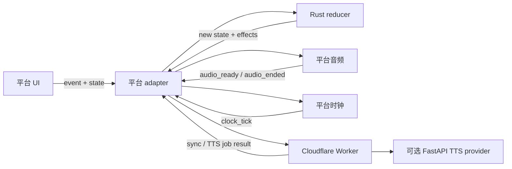

# Readio 跨平台 Rust Core 架构

本文定义 Web、Apple、TUI 和浏览器插件共享业务逻辑的边界。当前阶段已经落地播放、Manual/Auto/Read-aloud 模式与六档 effort、Unicode-scalar 阅读进度与证据化 ETA、DocumentRevision、Unicode scalar 权威位置、全文搜索、书签语义、内容身份与导入所有权计划、HTML/Markdown/plaintext/PDF/EPUB 解析、Loro Replica、WASM/私有 C ABI、typed `@readio/sdk`、Cloudflare D1/R2 同步边界和 TUI CRDT 云同步。Web 与浏览器插件运行同一 WASM；Apple 使用同一 Rust SDK 的私有 C ABI；TUI 直接依赖 Rust crate。

## 所有权

| 层 | 负责 | 不负责 |
| --- | --- | --- |
| `readio-core` | 播放状态机、时钟决策、预取策略、睡眠计时器、scalar 阅读进度/ETA/seek、Document IR/Revision、Unicode scalar locator/高亮、HTML/Markdown/plaintext/PDF/EPUB 解析、全文搜索与书签语义、内容身份和导入/忘记所有权计划 | UI、CSS 视觉计算、系统时钟读取、音频设备、HTTP、文件系统、密钥 |
| `readio-sdk` | 对三端暴露统一的 core facade、Loro entity/change/snapshot/heads 语义 | 平台持久化、网络传输、账户和服务端策略 |
| `readio-bridge` | Rust 类型与稳定 JSON 协议之间的编解码 | 平台行为和业务分支 |
| Web / Extension / Apple / TUI adapter | 把平台事件送入 core，并执行 core 返回的 effects | 复制播放状态机、解析、身份或同步规则 |
| Cloudflare Worker | 匿名且有预算的 URL acquisition、Auth/ACL、D1 change log/device cursor、R2 snapshot/content、额度/计费和云 TTS Job 编排 | HTML 业务解析、客户端 CRDT 冲突决策、浏览器/设备音频播放和界面状态 |
| 可选 FastAPI provider | Python TTS provider 执行和私有模型运行时 | 用户状态同步、客户端必需 API、业务权威数据 |

依赖方向始终从平台指向 core；core 不依赖 Next.js、Swift、终端框架或 FastAPI。



## 为什么时钟和播放这样拆

平台提供事实，Rust 做决定：

- 单调时钟、墙上时钟和实际音频位置由平台采样。
- Rust 决定何时继续 tick、暂停、持久化、切句和预取。
- WebAudio、AVFoundation 和 TUI 音频实现只执行 `play_audio`、`pause_audio` 等 effect。
- 每次 fetch/play/seek/pause/source change 都由 Rust generation 标识；audio ready、ended、failed 和 clock tick 必须同时匹配 sentence 与 generation，过期结果即使跳回同一句也不能接管当前游标。
- seek 在音频加载前保存精确毫秒 offset，metadata/音频到达后仍从同一 offset 开始；加载中的 pause 会立即作废 pending generation。

这避免把跨 FFI 的异步 trait 当成共享抽象，也避免三端各写一套计时器状态机。

## 诚实进度与 ETA

`reading::project_reading_progress` 是进度条和剩余时间的唯一计算器。输入是各 segment 的 Unicode-scalar 长度、当前 segment、segment 内 basis points，以及平台提供的 timing evidence；segment 间 canonical separator 也计入总长度。输出固定包含全局 `char_offset`、`char_count`、`progress_basis_points`、剩余字符和带 kind/sample count 的 ETA。`resolve_reading_seek` 把进度条 basis points 反投影成同一 scalar 坐标与 segment cursor，平台不再按句子数量分配距离。

证据规则是封闭的：Manual 或无事实时为 `unknown + null`；Auto 只接受明确的 text characters/second；Read-aloud 只接受平台解码器观察到的 segment audio duration、当前 media position 和 playback rate。Rust 用实际字符长度外推未观察音频，并按实时 rate 换算墙上时间。云端 job placeholder、prefetch 估值、句子均值和 UI timer 都不能升级为 ETA 证据。

该契约通过 `readio-sdk`、JSON bridge、WASM、私有 C ABI、typed TypeScript 与 Swift SDK 暴露。Web 的 `HTMLMediaElement`、Apple 的 `AVAudioPlayer` 只采样事实；UI 只显示 Rust projection。整数百分比仍可写入旧 metadata，但只能由 scalar basis points 四舍五入产生。

## Document 与媒体边界

HTML 不跨平台共享 DOM，而是先变成版本化的 Document IR：

- 当前 `ir_version` 为 `1`。
- 当前 parser version 为 `html-ir-3`。IR v1 的可选 `inline_spans` 只保留 `<em>/<strong>` 等文档明确表达的语义；共享 Core 不执行 stylesheet、class 或 inline CSS 的视觉级联。每个 half-open range 以规范化文本的 Unicode scalar 为坐标，并同时表达 bold/italic，旧的无该字段内容仍可读取。
- `reader::parse_markdown_reader` 先把受输入预算约束的 Markdown 转成 heading、paragraph、quote、code 与 inline emphasis 等 Document semantic blocks，再生成 `markdown-reader-ir-1` 的完整 Reader IR；`parse_plain_text_reader` 使用 `plain-text-reader-ir-1`。平台只选择 parser，不解析 Markdown 语法、不重新分句，也不根据渲染 DOM 重建导航。
- canonical reader text 在 block 间插入一个换行；所有持久位置都是该文本中的 Unicode scalar offset，不是 UTF-8 byte 或平台 UTF-16 index。
- `DocumentRevision` 包含 BLAKE3 内容身份、parser/IR version、revision digest 和 scalar char count。
- block ID 基于内容稳定生成；重复 block 使用确定性后缀。
- author-provided HTML fragment 被映射到稳定 block ID；EPUB 3 nav 与 EPUB 2 NCX 只输出可解析到线性 spine chapter/anchor 的导航目标，Web 和 Apple 不再各自解析目录 XML。
- script、style、template、SVG、导航和页脚等非正文内容会被丢弃。
- 图片只接受安全来源，并受输入字节数和 block 数预算限制。
- PDF text layer、扫描件识别阈值、EPUB package metadata、spine 顺序、`linear=no`、chapter Document IR 和 archive asset lookup 的唯一实现在 `readio-core::media`；`readio-sdk::media` 只是稳定 facade。同一实现已编译进 Web/Extension WASM、Apple FFI，并被 TUI 直接消费。
- PDF parser revision 为 `pdf-ir-1`。`ParsedPdf` 同时返回 title、author、page count、canonical text 和带 page range 的 chapter `Document`；每个 semantic block 另有 block-to-page provenance。页眉/页脚/孤立页码清理、跨页段落拼接、英文断词修复、CJK 拼接、heading 分章都由 Core 决定；有 outline 时优先使用其页范围，无可靠结构时按 3000 字左右且不切断页面的边界回退。平台只投影这些结果，不再根据 glyph、行宽或页码重建章节。
- EPUB 图片使用归一化 archive href 的 SHA-256 作为稳定 asset ID。只有 manifest 声明且 MIME 受支持的图片可寻址；原始 bytes 不进入 Document IR，而是在视图确实需要时从本地原 EPUB 提取，单个 asset 上限为 32 MiB。
- C ABI 以 owned byte buffer 返回 EPUB asset，并由 Apple 调用 `readio_bytes_free`；该二进制路径不经过 JSON/Base64。

`TextLocator v1` 是跨 revision 的恢复凭据，不是另一个并行位置。当前 revision 内，canonical scalar `char_offset + affinity` 仍是权威坐标；revision 改变后，恢复顺序固定且可审计：

1. revision 相同则使用 exact scalar offset；
2. 否则使用 stable block ID + block-local scalar offset；
3. block 不存在时只接受唯一最佳的 exact/prefix/suffix text quote；
4. quote 缺失或歧义时明确退回旧 scalar offset，绝不按 DOM path、UTF-16 或最近字符串猜测。

quote 的 exact/prefix/suffix 都有固定长度预算。Web、Apple 与 TUI 在保存 reading position 时持久化 locator；旧的无 locator 记录继续兼容。

`DocumentTextIndex v1` 为每个 semantic block 生成稳定 sentence ID、block-local/document-global scalar range 和 Unicode word range。播放层只提交 sentence index 与可选 word index 或 `word_progress_basis_points`，Rust `resolve_highlight` 决定当前 sentence/word；Web 只映射到 DOM，Apple 只映射到 native attributed text，TUI 只映射到 UTF-8 byte/cell range。平台不得再次分句、计词或用平台字符串单位解释业务坐标。

下一批适合沉淀到 Rust 的能力包括媒体容器轨道归一化、MIME sniffing、字幕/时间轴解析和统一内容指纹。文件选择、网络下载、图片/音频解码器和系统媒体会话仍由平台或后端提供。

## 平台接入

### Web

`packages/readio-sdk` 提供 Web/Extension 共用的 typed WASM facade；`apps/web/lib/readio-core-runtime.ts` 只初始化一次 checked-in bindgen 产物。本地文件先由 WASM 计算全字节身份，再由 Rust 返回 duplicate/copy/forget plan。PDF 与 EPUB publication IR 在导入时由 Rust 生成并以 `readio-pdf-v1` / `readio-epub-v1` 持久化，新 reader 直接投影这些结果，不再运行 PDF.js/epub.js 第二套解析；保留原始 bytes 的旧记录也先经同一 WASM 重新解析，只有原文件不可用或解析失败时才显示已有纯文本兜底。`.md` / `.markdown` 导入保留 `markdown` content format，内置样例保留 authored `markdown_source`；`content-router.tsx` 只据此选择 Rust Markdown reader parser，React 不解释 Markdown。已持久化的结构化 IR 不依赖原 archive 才能显示正文。Rust TOC block target 同时投影为全书 sentence cursor，目录点击与上一/下一章控制因此 seek 同一个播放/进度状态，而不是只滚动 DOM。EPUB 正文图片进入视图后才读取原 archive 并调用 Rust 提取，typed Blob URL 按 asset ID 缓存且在 reader 卸载时统一释放；文库封面使用相同的 `readio-epub-asset:` 引用按需加载，失败时保留稳定 placeholder。URL 导入先经 `/api/cloud/v1/acquire/url` 的同源 proxy 取得 bounded raw HTML，再由 WASM 生成 canonical text/identity。Web reading position 同时保存 scalar offset 与 Rust locator，revision 变化时经 Rust 恢复；播放进度经 Rust `DocumentTextIndex/resolve_highlight` 取得 word range，React 不再按 DOM token 数猜测。浏览器只执行 owned-content、SQLite/IndexedDB、网络和 UI effects，并把 metadata/outbox 放进 Loro Replica；匿名路径不初始化云同步。

WASM 生成由 `make wasm-web` 统一完成。workspace 与 CLI 都固定在 `wasm-bindgen 0.2.126`，Make target 先检查 CLI schema，再用 stable toolchain 构建 `wasm32-unknown-unknown` 并生成 Web glue。`use-tts-player.ts` 已由 `WebPlaybackExecutor` 正式接管：React 只投影状态和提供 TTS/cache effect，`BrowserPlaybackPlatform` 唯一持有 Audio 与 Timer，并在 pause/resume 时复用同一媒体元素。首次 play 即按 Rust policy 预取，异步 fetch 不阻塞 pause；`audio_ready` 会等待真实 media metadata，不再注入固定时长。Manual/Auto/Read-aloud 的整本进度、ETA、scrub seek、旧百分比恢复与持久化都通过 WASM scalar projection，Manual 不显示 ETA，音频时长只有 `loadedmetadata/timeupdate` 后才成为 evidence。`BrowserMediaSessionController` 只把系统 play/pause/next/previous 事件送回同一个 player command port，并从 Rust 状态投影 metadata、playbackState 和采样的 duration/position/rate；未知 duration 时主动清空系统 position state，系统媒体层不拥有第二套播放状态。

Web 不在浏览器复制 Python TTS provider，普通本地阅读和新 URL 导入也不依赖 FastAPI。Cloudflare acquisition 允许匿名本地用户使用，但只接受公开 HTTP/HTTPS hostname，手动跟随并逐跳复验至多五次 redirect，只缓冲明确受 5 MiB 上限保护的 HTML stream，并把中断/媒体类型/上游状态映射成结构化恢复错误。`cloud-tts-client.ts` 经同源 proxy 创建/轮询 Cloudflare TTS job，Worker 用 D1 保存权威 job 状态、Queue 执行任务、R2 私有流返回音频；未登录只在用户请求云 TTS 时得到明确 401，普通本地阅读不受影响。浏览器本地 TTS/WASM 推理以后可以作为可选音频 provider；Cloudflare 也可以调度可选 FastAPI/Python provider。

### 浏览器插件

插件从 `@readio/sdk` 获取与 Web 相同的 typed facade，只把 active-tab selection/article HTML、Chrome permission、popup UI 和 `chrome.storage.local` 当作平台 effects。捕获内容先经 Rust HTML parser、canonical identity 和 import plan；metadata 进入同一 `ReadioSyncState`，序列化 snapshot/outbox 与正文、原 HTML 一起本地落盘，因此未登录也能保存并在重启后恢复。旧 FastAPI library path 已删除，FastAPI 只保留显式配置的本地 TTS provider。下一步只需增加认证与 Cloudflare transport，把已有 outbox push/pull；不得另写同步 reducer。

### Apple

表现层使用同一个 SwiftUI target 覆盖 iPhone、iPad 与原生 macOS；AppKit 只在菜单、窗口、焦点和文件面板等 SwiftUI 不足的 macOS 行为处作为 adapter。`ReadioSDK.swift` 封装 C string/opaque Replica handle、JSON/Base64 和原始 byte buffer 生命周期；音频、时钟、网络与系统媒体控制由 Apple adapter 实现。

当前 C header、module map、playback/document/position/search/bookmark/storage/import-plan/EPUB-asset API、Loro change/snapshot API 和真实 Swift→Rust 行为测试已完成。`ReadioSDK.swift` 提供类型化 content identity、import/forget plan、reading progress/seek、highlight document/cursor/target、`AppleTextLocator` 和原始 `Data` asset 提取；`LibraryService` 执行 Rust effects，并在 iPhone、iPad 与原生 macOS 间共享 deterministic ID、duplicate progress reuse、link-safe forget 和 stable asset lookup。PDF 导入保存原始 bytes 与 `readio-pdf-v1` publication JSON，`RustPDFPublication` 只把共享 chapter Document/page provenance 投影到现有 native structured reader；Swift 不再重做页、行、段落或章节判断。正文图片与 cover 都从保存的原 EPUB 按需提取，再交给 UIKit/AppKit 原生图片解码，失败时保留平台 placeholder。Apple URLSession 只 acquisition 原始 HTML；`LibraryService` 随后调用 Rust HTML parser，以 canonical text 的 UTF-8 字节计算 identity，并只在 created/updated plan 保存原始 HTML，因此 URL 重复导入与 Web 一样保留既有标题和进度。`ReadioPlaybackExecutor` 与 `ReadioTextAdvanceExecutor` 已加入 Xcode target，`TTSPlaybackEngine` 只执行合成、缓存、`AVAudioPlayer`、系统时钟、Auto timer、AVAudioSession 和 Now Playing effects；play/pause/seek/切句/失败/预取/generation/deadline 决策全部回到 Rust。Player 可在运行中把同一句从 Manual、Auto 和 Read-aloud owner 间转移，Rust 解析的六档 effort 同时更新文本 deadline 和音频 rate，同值偏好通知不会制造第二次 seek。`currentWordProgress` 只保留为原始媒体 fraction transport；实际高亮由 Rust `resolve_highlight` 返回 `ReadioScalarRange`，SwiftUI 只按 scalar 切分 `AttributedString`，已删除 Apple 本地 token counter。底部整本进度条使用 Rust `progressBasisPoints`；Manual ETA 为 unknown，Auto 使用 Rust text rate，Read-aloud 只把解码后的 `AVAudioPlayer.duration/currentTime/rate` 作为 observation。Apple Reader 的 EPUB 与 PDF 章节共享一个 whole-book DocumentRevision/scalar 坐标，Rust 搜索、书签、初次恢复与同步后的远端位置都会先选择目标章节，再通过一个原子的章节替换与 seek 边界交给播放器；TOC fragment、query/hit walking 与 bookmark default passage/rename 都保留在同一 Reader tools 状态。playback/text 的 `persist_progress` 进入 latest-wins 串行 writer，再使用当前 DocumentRevision、scalar offset 和 locator 写入 Apple 本地 Loro Replica；旧整数百分比由同一 whole-book scalar projection 产生，revision 变化后恢复仍由 Rust 决定。章节替换会保留活动状态、重建 reducer state，并拒绝旧章节的迟到 completion。系统 interruption/route loss 作为事实输入重新调用 Rust pause/resume；sleep timer 使用 Rust wall-clock deadline，Apple 只投影剩余时间和预设控件。加载中 pause、Auto 换章、live mode/effort、scalar seek/ETA、typed highlight、whole-book search/bookmark、跨 revision locator、coalesced progress、interruption/route、sleep deadline、structured PDF 与 EPUB asset bytes 的真实 Swift integration tests 覆盖这些不变量。Xcode target 通过 `apps/ios/scripts/build-rust-core.sh` 按 iPhone、Simulator 或原生 macOS 架构选择不同 Rust triple 并链接 staticlib；原生 macOS 全量 Swift surface、focused-window menus、scene restoration 与 Rust staticlib 已由自动化测试保护，签名和完整 UI journey 仍需在完整 Xcode 环境验收。

### 同步与服务端权威边界

Library metadata、reading position、bookmark 和用户设置进入 Loro Replica。Web 与 Extension 通过 WASM，Apple 通过 `ReadioSDK.swift` 背后的私有 C ABI，TUI 直接调用 Rust crate。客户端先把 snapshot 与 outbox 原子保存，再 push；change ID 是 immutable Loro update 的 SHA-256，因此断网或崩溃后的重放可由 D1 去重。Extension 已持久化同一 outbox，但认证后的 Cloudflare transport 仍待接入。

Cloudflare Worker 把 change log、device heads/ack cursor 和用户隔离放在 D1，把私有二进制 snapshot 与大内容放在 R2。客户端 cursor 只在 pull change 成功 import 并落盘后推进；push 返回的 server high-water 不能直接当作本地已导入 cursor，必须 post-push pull 后才上传绑定 cursor 的 snapshot。

Auth、ACL、额度、计费和 TTS Job 不进入 CRDT，始终由服务端权威处理。URL acquisition 也是服务端 effect，但返回的原始资源不是权威文库数据：Rust canonical projection 与客户端 import plan 才决定 identity 和持久化。旧 FastAPI library/position/bookmark API 暂时作为迁移兼容面；FastAPI 的长期角色仅是可选 TTS provider，不是三端使用、URL 导入和同步的前置依赖。

未填写书签名时，Rust 先用 offset + affinity 投影到当前 Document block，再从该结构块生成有长度上限的规范化预览。这样 Web、Apple 与 TUI 会得到同一个默认名，并避免跨段落或从单词中间开始的上下文碎片。

### TUI

TUI 直接依赖 `readio-sdk`，无需 JSON/FFI。新文件导入使用与 Web/Apple 相同的全字节 identity、duplicate reuse、`import_record` 和 import/forget effects；copy/link/move 的实际文件 I/O 仍由 TUI adapter 执行，并把 owned-content 删除限制在 Readio books 目录。显式切换所有权通过 `replace_ownership` 与普通重复导入区分：普通重复导入保留既有 ownership，用户明确切换时 Rust 返回 `updated` plan，且始终 write-before-delete。旧版 16 位 FNV ID 不会被重写；首次匹配到相同 shared identity 时继续以旧 ID 访问 state.json 的进度与书签，同时补齐新的 import metadata。HTML、EPUB 与 PDF 的业务解析都来自 `readio-core::documents/media`；原有独立 PDF 页眉、断词、outline 和分章 parser 已删除。TUI adapter 只把 chapter Document semantic blocks 投影成 terminal paragraphs，并按需把 EPUB 图片 bytes 物化为终端解码器需要的文件，不再拥有 XHTML、EPUB package、PDF 重建、anchor 或 CSS emphasis 规则。TUI `Progress` 同时持久化 scalar fallback 与 Rust locator，并把 locator 放入 Loro reading-position payload；媒体进度通过 Rust text index/高亮 resolver 后才映射成 byte/cell range。`replica_sync.rs` 持久化 Loro snapshot/outbox，`cloud.rs` 执行 pull/import、local stage、persist-before-push、ack、post-push pull 和 R2 binary snapshot 上传；完全不登录时本地阅读路径不触发这些模块。

## 协议规则

- event/effect 使用 snake_case tagged JSON，例如 `{"type":"clock_tick"}`。
- Import request 缺省把相同 identity 视为普通 duplicate；只有显式 `replace_ownership: true` 才允许改变 copy/link/move，并保持原 item ID。
- Document IR 每次不兼容变更必须提升 `ir_version`。
- `char_offset` 只解释为 canonical reader text 的 Unicode scalar boundary；平台只能在渲染边界做 scalar→DOM/UTF-16/UTF-8/cell 投影，不得本地重做恢复、分句或计词业务规则。
- C ABI 返回的 `value` 和 `error` 都由 Rust 分配，调用方必须用 `readio_string_free` 释放。
- 平台 adapter 可以新增执行能力，但不得在本地重新解释同一个业务状态分支。

## 验证入口

```bash
make test-core
make check-wasm
make wasm-web
cargo test --manifest-path apps/tui/Cargo.toml
pnpm --filter @readio/cloud typecheck
pnpm --filter @readio/cloud test
pnpm --filter @readio/web test
pnpm --filter @readio/extension test
pnpm --filter @readio/extension build
/bin/bash apps/ios/scripts/test-build-rust-core.sh
```

`make check-wasm` 需要先安装 `wasm32-unknown-unknown` target。开发期不要用 Next.js production build 验证该层。

## 后续迁移顺序

1. 完成 Apple 前后台恢复和三端 exact-position E2E 验收。
2. 给 Web/Apple sleep timer 增加 UI-suspension 与真机锁屏验收。
3. 在发布流水线产出可复用 XCFramework，并补齐 native macOS 菜单、窗口恢复、签名和 UI journey。
4. 将媒体元数据、字幕/时间轴和更多文档格式按同样的 IR + budget 模式沉淀到 Rust。
